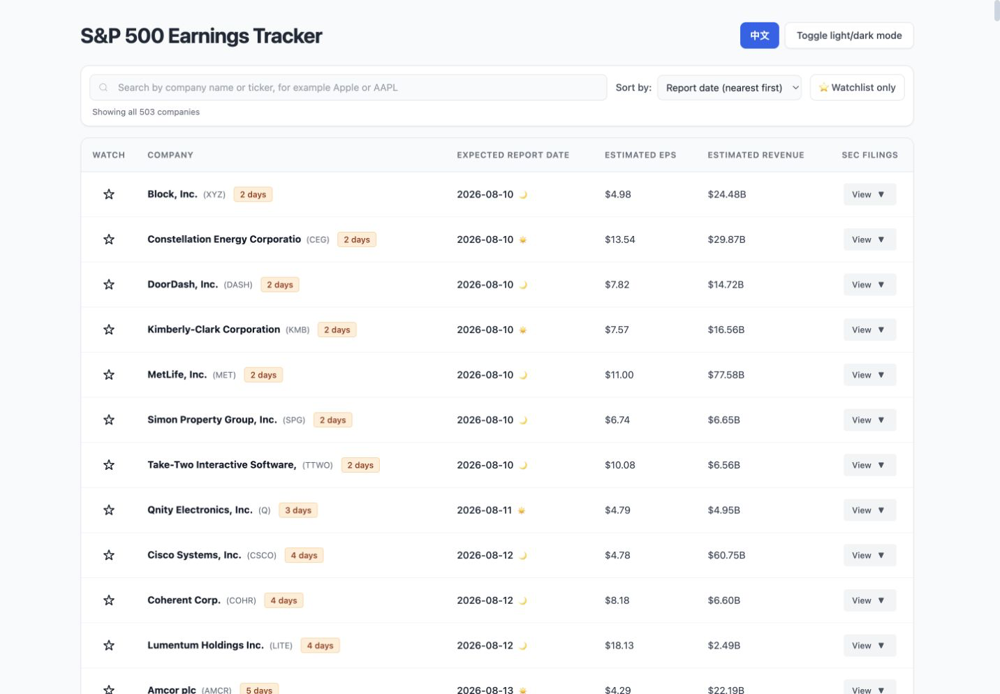

# 📈 S&P 500 Earnings Tracker

This personal project tracks expected earnings dates, BMO/AMC timing, and recent SEC 10-Q and 10-K filings for companies in the S&P 500.

**Live site:** [ianhoutsai-afk.github.io/earnings-tracker](https://ianhoutsai-afk.github.io/earnings-tracker/)

## Project Motivation

I independently defined the product requirements for this personal project and used AI-assisted development to help implement and review parts of the code. I personally test the workflows, validate the output, and maintain the project as its requirements and data sources evolve.

---

## English

### Features

- **S&P 500 coverage:** Uses a cached constituent mapping and tracks roughly 500 companies.
- **Earnings schedule:** Displays expected report dates and BMO/AMC timing when the source data provides it.
- **SEC filing history:** Links recent matched 10-Q and 10-K filings and labels filings using each company's fiscal calendar.
- **Local watchlist:** Stores selected tickers in the browser, with watchlist filtering and JSON import/export.
- **Search and sorting:** Filters by company, GICS sector and New York date, with quarterly EPS and revenue trends in history.
- **Bilingual interface:** Opens in English by default and can switch to Traditional Chinese. The selected language is retained in the browser.
- **Display controls:** Includes light/dark themes and a horizontally scrollable table for smaller screens.

### Deployment

1. Select **`Use this template`** → **`Create a new repository`** and create a public repository.
2. Open **`Settings`** → **`Actions`** → **`General`** → **`Workflow permissions`**, select **`Read and write permissions`**, and save.
3. In **Settings → Pages**, choose **GitHub Actions** as the publishing source.
4. Run **Earnings Tracker Pages**. The first deployment can seed from the checked-in data.
   Subsequent update runs publish validated archives to GitHub Releases.

For an existing branch-based site, allow an update to publish a release snapshot first.
Then switch the Pages source and run **Earnings Tracker Pages**. To redeploy a prior
data snapshot, enter its release tag in the workflow's optional `snapshot_tag` input.
The deployed site uses build-time CSS, a compact summary, and on-demand company history.

### Controlled SEC Proxy and Fair Access

Direct SEC requests from some cloud-hosted environments may be unavailable or unreliable. `proxy-worker.js` can be deployed as a controlled Cloudflare Worker relay for authorized requests from this repository. It is not intended to evade SEC access controls and does not exempt an operator from the SEC's rules.

The deployment must follow the current [SEC Fair Access requirements](https://www.sec.gov/about/developer-resources): use efficient scripts, request only the data needed, identify automated traffic, and keep aggregate traffic within the SEC's published request-rate limit. At the time of this README revision, the SEC publishes a limit of no more than 10 requests per second in total, regardless of the number of machines used.

1. Create a Cloudflare Worker and paste in `proxy-worker.js`.
2. Add an encrypted Worker secret named `PROXY_TOKEN`. Generate a random value, for example with `openssl rand -hex 32`, and never commit the value.
3. Add `SEC_CONTACT_EMAIL` with a monitored contact address used by the SEC request `User-Agent`.
4. Deploy the Worker and record its URL.
5. Add matching GitHub Actions secrets:
   - `PROXY_TOKEN`: the same token stored by the Worker.
   - `SEC_PROXY_URL`: the deployed Worker URL.
   - `SEC_CONTACT_EMAIL`: the monitored contact address.
6. Run **`Earnings Tracker Update`** manually, confirm the controlled proxy works, and retire any previous token.

The Worker returns HTTP 503 when `PROXY_TOKEN` is not configured and HTTP 401 when the request token is missing or does not match. Local runs can call the SEC directly with `SEC_CONTACT_EMAIL` configured and do not require the Worker.

### Technical Overview

- **Data update:** Python 3.11, `yfinance`, and `requests` with retry handling.
- **Frontend:** Tailwind CSS, browser ES modules, Vanilla JavaScript, and `localStorage`.
- **Automation and hosting:** GitHub Actions and GitHub Pages.
- **Optional workers:** Optional Cloudflare Worker for controlled SEC requests.

### Quarterly earnings history refresh

Every tracked issuer now uses the same maximum-five-quarter policy. The website and active JSON files show newest first; original releases, filings, reporting-period ends and future calls remain separate. Five verified quarters cannot be displaced by an unverified candidate or a replayed old seed. Short histories remain short with an explanation.

`python official_sync.py --full` checks every issuer using SEC submissions and original earnings exhibits, once per CIK. It validates explicit release dates and quarter identity, then reads matching quarterly inline-XBRL facts from official filings. NVIDIA keeps its independently verified newsroom adapter. The hourly **Official Quarterly History** workflow (registered file `nvda_history.yml`) checks the reporting window and stale/failed issuers; daily full runs also cover undated companies. Official public documents are cached and requests are paced. A configured proxy can fall back to direct official requests; no private data service is required.

Only verified quarterly GAAP diluted EPS and USD revenue appear as actual values. Missing or unsupported facts remain blank; annual/YTD EPS and revenue components cannot substitute for a quarterly total. Legacy fiscal labels and dates are explicitly unverified, and their unsupported figures remain in storage/Git but are hidden on the site. Unknown-period forward estimates are withheld for every company. Each metric retains its own source through partial restatements.

`python verified_history.py --scan` still discovers Yahoo dates only, never importing third-party actuals. Future estimates are labelled and expired dates are cleared using the New York calendar. `history_status.json` records per-company source failures, parsing gaps and coverage; `official_scan_state.json` summarizes the run. A successful source connection is not proof that every financial field or every latest quarter is verified. Failures preserve history and are published visibly before the workflow fails. `python validate_quarterly_data.py` gates every publication bundle.

See [source setup and known coverage boundaries](docs/official-source-setup.md), the [migration audit](docs/all-company-quarterly-migration.json), and the [approved full-site design](docs/superpowers/specs/2026-10-22-all-company-quarterly-design.md).

---

## 中文

### 功能

- **S&P 500 成分股範圍：** 使用快取的成分股映射，追蹤約 500 家公司。
- **財報時間表：** 顯示預計發布日期；資料來源提供時間資訊時，標示盤前或盤後。
- **SEC 申報紀錄：** 連結配對後的近期 10-Q 與 10-K 文件，並依各公司財年標示季度。
- **本機收藏清單：** 在瀏覽器保存關注股票，支援收藏篩選和 JSON 匯入、匯出。
- **搜尋與排序：** 可按公司、GICS 產業及美東財報日期篩選，展開歷史可查看季度 EPS 與營收趨勢。
- **中英文介面：** 首次開啟預設為英文，可切換至繁體中文；瀏覽器會保留語言選擇。
- **顯示設定：** 提供日／夜模式；較小螢幕可橫向捲動表格。

### 最新季度歷史資料

全站公司共用最多五季、最新在前的保留規則，資料檔與畫面都生效。新季度需有官方公布證據才入庫；已有五個核實季度時，未核實線索不會擠掉舊季。實際不足五筆者顯示缺漏，不捏造補滿。

每小時的 **Official Quarterly History** 工作流程會檢查發報窗口及過期／失敗來源；每日完整掃描包含沒有預計日期的公司。依 CIK 合併共用來源，核對 SEC 原始業績公告的公布日、季度及匹配申報的季度 GAAP 數字。NVIDIA 保留官方新聞室來源。官方文件採快取與限速；代理失效時可改試官方直連。

財年、季度截止日、公布日、SEC 申報日與電話會議分開顯示。未核實舊日期、季度及缺漏數值明確標示；未確認季度口徑的歷史數字及不明期間的預期 EPS／營收不再顯示為實績或下一季預估。數值修訂逐欄保存來源，全年／累計 EPS 不拿來推算 Q4。

來源失敗會保留原紀錄並顯示異常，工作流程會在保存狀態後明確失敗；連線成功不代表所有季度和欄位均核實。[來源設定及覆蓋限制](docs/official-source-setup.md)列出必要設定與待補情況；[遷移稽核](docs/all-company-quarterly-migration.json)逐家公司記錄裁切及缺漏。

### 部署

1. 點擊 **`Use this template`** → **`Create a new repository`**，建立公開倉庫。
2. 前往 **`Settings`** → **`Actions`** → **`General`** → **`Workflow permissions`**，選擇 **`Read and write permissions`** 並儲存。
3. 前往 **Settings → Pages**，將發布來源設為 **GitHub Actions**。
4. 執行 **Earnings Tracker Pages**。首次部署可以使用 Git 內的基準資料，後續更新會將通過驗證的財報快照發布到 GitHub Releases。

既有的分支部署網站先等更新工作流程發布一份快照，再切換 Pages 來源並執行部署。需要回退資料時，在 **Earnings Tracker Pages** 的 `snapshot_tag` 輸入先前的 release 標籤。部署版網站使用建置產生的 CSS、精簡的主表資料與按需載入的公司明細。

### 受控 SEC 代理與 Fair Access

部分雲端環境可能無法穩定直接連線 SEC。`proxy-worker.js` 可部署為受控 Cloudflare Worker 代理，只接受本倉庫經授權的請求。本項目在需要時使用受控代理，並遵守 SEC Fair Access 要求；此代理不是用來規避 SEC 存取控制。

部署時必須遵守 SEC 最新的 [Developer Resources and Fair Access 指引](https://www.sec.gov/about/developer-resources)：使用有效率的程式、只請求所需資料、識別自動化流量，並讓所有機器的合計流量維持在 SEC 公布的限制內。本 README 修訂時，SEC 公布的上限為合計每秒不超過 10 個請求。

1. 建立 Cloudflare Worker，貼上 `proxy-worker.js`。
2. 新增加密 Worker Secret `PROXY_TOKEN`。可用 `openssl rand -hex 32` 產生隨機值，且不得提交至 Git。
3. 新增 `SEC_CONTACT_EMAIL`，填入有人監看的聯絡信箱，供 SEC 請求的 `User-Agent` 使用。
4. 部署 Worker 並記下網址。
5. 在 GitHub Actions 新增相符的 Secrets：
   - `PROXY_TOKEN`：與 Worker 相同的 Token。
   - `SEC_PROXY_URL`：部署後的 Worker 網址。
   - `SEC_CONTACT_EMAIL`：有人監看的聯絡信箱。
6. 手動執行 **`Earnings Tracker Update`**，確認受控代理可用，並停用任何舊 Token。

Worker 未設定 `PROXY_TOKEN` 時會回傳 HTTP 503；請求未提供相符 Token 時會回傳 HTTP 401。本機執行可在設定 `SEC_CONTACT_EMAIL` 後直接連線 SEC，不需要 Worker。

### 技術概覽

- **資料更新：** Python 3.9、`yfinance`、`requests` 與重試處理。
- **前端：** Tailwind CSS、瀏覽器 ES Modules、原生 JavaScript 與 `localStorage`。
- **自動化與託管：** GitHub Actions 與 GitHub Pages。
- **選用 Worker：** 受控 SEC 請求可使用 Cloudflare Worker。

### 維護

S&P 500 成分股有變動時，可在 **Actions** 頁面手動執行 **`Build S&P 500 Cache`**，透過 DataHub 更新快取。

### 免責聲明

本工具僅供資訊參考。財務資料來自 Yahoo Finance 與 SEC 等公開來源，可能有延遲、缺漏或錯誤。投資決策應以公司公告及 SEC 官方申報文件為準。
